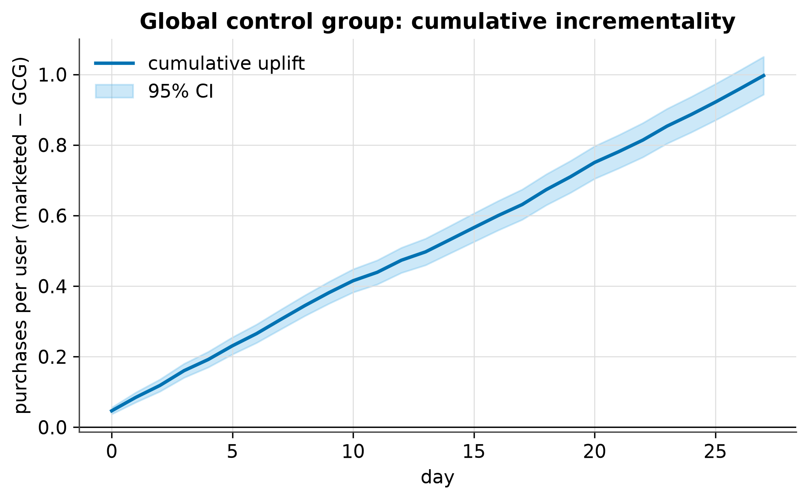

<!-- ascii-art: pyfiglet + ascii-bin (CC0) -->
```text
                                       _               _       _      _
 __ _ _ _ __ ___ _____ ___ __  ___ _ _(_)_ __  ___ _ _| |_ ___| |__ _| |__
/ _| '_| '  \___/ -_) \ / '_ \/ -_) '_| | '  \/ -_) ' \  _|___| / _` | '_ \
\__|_| |_|_|_|  \___/_\_\ .__/\___|_| |_|_|_|_\___|_||_\__|   |_\__,_|_.__/
                        |_|

╭──────────────────────────────────────────────────────────────────────────╮
│ CRM communication experiments break the assumptions of generic produc... │
╰──────────────────────────────────────────────────────────────────────────╯
━━━━━━━━━━━━━━━━━━━━━━━━━━━━━━━━━━━━━━━━━━━━━━━━━━━━━━━━━━━━━━━━━━━━━━━━━━━━
```

# CRM Experiment Lab

> A global control group measures **+0.9968** cumulative purchases per user; net of churn the campaign is **+50.5** per 1,000 treated (uplift +212.8 − unsub +162.3) — verdict **Investigate**, because the unsubscribe guardrail regresses ([readout](outputs/ab_test_report.md)).

**Public link:** [демо — HTML-отчёт, скачать и открыть в браузере](https://github.com/NikitaBoyarkin/crm-experiment-lab/blob/main/reports/readout/crm-experiment-lab-readout.html) · [кейс](https://nikitaboyarkin.github.io/projects/crm-experiment-lab/) · [исходники](https://github.com/NikitaBoyarkin/crm-experiment-lab)

## Navigation
- 🌐 [Portfolio site](https://nikitaboyarkin.github.io)
- 🏦 [Flagship case: Volta neobank](https://github.com/NikitaBoyarkin/volta-banking)
- 🧪 Related: [ab_test](https://github.com/NikitaBoyarkin/ab_test) · [causal-uplift](https://github.com/NikitaBoyarkin/causal-uplift) · [browser-mini-games](https://github.com/NikitaBoyarkin/browser-mini-games)

**On this page:** [Situation](#situation) · [Task](#task) · [Actions](#actions) · [Result](#result) · [Headline results](#headline-results) · [Quickstart](#quickstart) · [Modules](#modules) · [Testing philosophy](#testing-philosophy) · [Limitations & scope](#limitations--scope) · [Layout](#layout)

## Situation
CRM communication experiments break the assumptions of generic product A/B tooling. The same user is targeted by many campaigns, so randomization has to happen once, at segment-formation time; the worth of a campaign is not its purchases but the net of incremental purchasers minus unsubscribes; and a per-user daily notification cap has to be enforced. None of that is covered by a standard product-testing stack.

**Dataset.** Synthetic and seeded: `crm_lab.simulator` builds every table from one numpy generator (`SimulationConfig.seed`, default 42), so a run is byte-reproducible. The committed `data/experiment_sample.csv` is a 300-row outcomes-schema example, not a pipeline input; the numbers come from `uv run python scripts/run_full_pipeline.py`.

## Task
Build a synthetic CRM-communication experimentation platform that reproduces this CRM-specific layer on a known data-generating process, so every claim is reproducible from one seed.

## Actions
- Simulate a known-DGP CRM experiment with fixed per-user groups, a global control group, and capped sends.
- Randomize at segment-formation time and show that exposure-stage bucketing fires SRM.
- Estimate cumulative campaign uplift with the GCG, and compare a full vs partial control refresh.
- Enforce a per-user daily send cap in the balancer and spread sends over prime hours.
- Compute the net effect as incremental purchasers − incremental unsubscribes per 1,000 treated, plus the exposure window and guardrails.
- Calibrate the shared statistics against `statsmodels`/`scipy` rather than trusting the closed forms.

## Result
- **+0.9968** — GCG cumulative uplift per user by day 27 [+0.9433, +1.0502], CI excludes 0.
- **+50.5** — net effect per 1,000 treated (uplift +212.8 − unsub +162.3; ratio 1.31).
- **0.0075 vs 0.0061** — full-refresh CV vs partial-refresh CV once the refresh pool excludes marketed users: both strategies keep the baseline stable, the partial rotation ~1.2× more so. The 36× gap an earlier version reported came from drawing treated users into the control group.
- **p = 0.266** — segment-share SRM is balanced; first-activity bucketing breaks it (exposure share 0.5629, p ≈ 0).
- **3.0 ≤ 3** — the worst user-day still lands on the cap (delivered sends only, 0 violations) while the unsubscribe guardrail fires (+0.1623).

A synthetic CRM-communication experimentation platform that reproduces the
**CRM-specific** layer of A/B testing which generic product tooling misses:
randomization has to happen **once, at segment-formation time** (because the same
user is targeted by many campaigns), a **global control group** measures the
cumulative uplift of *all* campaigns together, a **send balancer** enforces a
per-user daily notification cap, and the campaign's worth is the **net** of the
incremental purchasers it drives minus the unsubscribes it causes. Everything runs
on a known data-generating process, so every claim below is reproducible from one
seed.

## Headline results

`uv run python scripts/run_full_pipeline.py` runs the whole flow on a default
synthetic experiment (20,000 users, 28 days, 12 campaigns, seed 42) and writes
`outputs/report.md` plus three figures:

| Analysis | Result | Reading |
|---|---|---|
| Randomization (SRM) | segment share 0.4958, p = 0.266; exposure share 0.5629, p ≈ 0 | fixed per-user split is balanced; first-activity bucketing breaks it |
| GCG cumulative uplift | +0.9968 purchases/user by day 27 [+0.9433, +1.0502] | marketed minus global control; the 95% CI excludes 0 |
| GCG refresh stability | CV full = 0.0075 vs partial = 0.0061 | both refresh strategies are stable when the pool excludes marketed users; partial is ~1.2× smoother. A full reshuffle can only hurt if it can draw treated users |
| Net effect / 1k treated | **+50.5** (uplift +212.8 − unsub 162.3; ratio 1.31) | positive once churn is priced in |
| Exposure window | effect any = 0.03621 (SE 0.00066) vs windowed = 0.03580 (SE 0.00132); transient DGP sensitivity 6.5 → 11.0 | the window anchors both arms to one pre-treatment horizon; it is *not* a free SE cut |
| Guardrails | unsubscribe +0.1623 (breach), worst user-day 3.0 ≤ cap | the unsubscribe guardrail fires; the cap holds on delivered sends (0 violations) |



*Cumulative marketed − GCG purchases per user by day, with the 95% band: +0.9968 by day 27 on [+0.9433, +1.0502]. The band stays narrow because the DGP's planted lift is constant in time — it says nothing about stability on real traffic.*

**Source of these numbers.** They come from the full simulator run
(`scripts/run_full_pipeline.py`: 20,000 users, 28 days, 12 campaigns, seed 42),
**not** from the committed `data/experiment_sample.csv`. That CSV is an
*outcomes-schema* example (300 rows) with no `group` column, so the uplift and net
figures cannot be reproduced from it — run the pipeline instead.

The point of the demo is that each step can **fail loudly**: an SRM check that
fires under the wrong bucketing, a cap guardrail that fires when a user-day
exceeds the limit, an unsubscribe guardrail that blocks the launch. Two things
the current DGP cannot demonstrate are stated as such rather than staged: the
refresh CV gap only appears if a refresh can pull treated users into the control
group, and per-campaign attribution needs a per-campaign outcome the simulator
does not record.

## What this proves

- **Randomization can happen once, at segment formation, and still be checked.**
  `pytest tests/test_randomization.py` pins both sides of it: the segment-stage
  split stays clean while exposure-stage bucketing fires SRM — the code is
  `src/crm_lab/randomization.py`, the two shares are in
  [Headline results](#headline-results).
- **A campaign is valued net of churn, not by gross purchases.** `net_effect` in
  `src/crm_lab/positivity.py` returns incremental purchasers minus incremental
  unsubscribes per 1,000 treated; `pytest tests/test_positivity.py` pins the sign
  and the decomposition.
- **The shared statistics are calibrated against independent implementations.**
  `uv run pytest tests/test_stats.py` checks `required_n` / `mde` against
  `statsmodels.stats.power.NormalIndPower`, `srm_chi2` against
  `scipy.stats.chisquare`, and the z-test p-value against
  `statsmodels.stats.proportion.proportions_ztest`.
- **Where it transfers:** lifecycle and campaign experiments where one user sits
  in many campaigns, a holdout has to survive for months, and a send-side
  constraint (cap, prime hours) is part of the design rather than of operations.
  The whole claim set is re-derived from one seed by
  `pytest tests/test_headline_numbers.py`, so the harness can be pointed at a
  different DGP.

## Quickstart

```bash
uv sync --all-groups                          # install deps + dev tools
uv run pytest                                 # calibration test suite
uv run python scripts/run_full_pipeline.py    # end-to-end -> outputs/report.md + plots/pipeline_*.png
uv run python scripts/ab_test_readout.py      # cap sweep + guardrail readout -> outputs/ab_test_report.md
uv run python scripts/make_figures.py         # one figure per module -> plots/
uv run ruff check src/ scripts/ tests/        # lint
```

Requires Python >= 3.11. Managed with [uv](https://docs.astral.sh/uv/).

## Modules

Each module proves one CRM-specific claim. The sources are the vault notes this
lab is built from.

| Module | What it proves | Vault source |
|---|---|---|
| `src/crm_lab/config.py` | one immutable config (cap, shares, window, rates) parameterizes every run | `Obsidian/Z-core/@Trisigma хэндбук эксперименты и метрики.md` |
| `src/crm_lab/contract.py` | the five-table data model + result containers every module agrees on | `Obsidian/Z-core/@Trisigma хэндбук эксперименты и метрики.md` |
| `src/crm_lab/stats.py` | two-proportion z-test, SRM χ², cluster-robust SE, bootstrap CI, MDE / required-n | `Obsidian/Z-core/@Trisigma хэндбук эксперименты и метрики.md`, `Obsidian/Z-core/Switchback experiments.md` |
| `src/crm_lab/plotting.py` | one shared Okabe-Ito headless style for every figure | — |
| `src/crm_lab/simulator.py` | a known-DGP CRM experiment: fixed per-user groups, GCG, capped sends | `Obsidian/Z-core/Как мы в Авито проводим AB-тесты CRM-рассылок.md` |
| `src/crm_lab/balancer.py` | the send balancer never exceeds the daily cap and spreads sends over prime hours | `Obsidian/Z-core/Как мы в Авито проводим AB-тесты CRM-рассылок.md` |
| `src/crm_lab/randomization.py` | segment-stage bucketing keeps the split clean; exposure-stage bucketing fires SRM | `Obsidian/Z-core/Как мы в Авито проводим AB-тесты CRM-рассылок.md` |
| `src/crm_lab/gcg.py` | the global control group estimates cumulative uplift; partial refresh beats full | `Obsidian/Z-core/Как мы в Авито проводим AB-тесты CRM-рассылок.md` |
| `src/crm_lab/positivity.py` | net effect = incremental purchasers − incremental unsubscribes, per 1,000 treated; the balance table is a segment-level ITT and says so in a `scope` column | `Obsidian/Z-core/Как мы в Авито проводим AB-тесты CRM-рассылок.md` |
| `src/crm_lab/exposure.py` | the `Is Exposed = True` window vs all-days metric — anchored at the pre-treatment experiment entry day, and sensitivity (not SE) is where the window pays off | `Obsidian/Z-core/@Trisigma хэндбук эксперименты и метрики.md` |
| `src/crm_lab/metrics.py` | OEC → driver → proxy → debug → guardrail hierarchy and the guardrail checks | `Obsidian/Z-core/@Trisigma хэндбук эксперименты и метрики.md` |
| `src/crm_lab/report.py` | assembles the markdown report from all of the above | — |
| `scripts/run_full_pipeline.py` | end-to-end: simulate → all analyses → report + three figures + stdout table | — |
| `scripts/make_figures.py` | one chart per module into `plots/` | — |

## Testing philosophy

The `tests/` suite calibrates the shared statistics against independent
implementations rather than trusting the closed forms:

- `required_n_proportion` / `mde_proportion` agree with
  `statsmodels.stats.power.NormalIndPower` across small and large rates, and are
  inverses of each other;
- `srm_chi2` matches `scipy.stats.chisquare`, does not fire on a clean 50/50 split,
  fires on a planted 60/40 one, and respects a non-uniform planned split;
- `two_proportion_ztest` p-values match
  `statsmodels.stats.proportion.proportions_ztest`, its CI covers the effect.

The wave-1 module tests pin the behaviours on hand-made fixtures: the balancer
never exceeds the cap, the GCG uplift CI covers the planted effect, the exposure
window truncates both arms symmetrically and lifts signal-to-noise on a
transient-effect DGP, and the net-effect sign matches the planted lift. Run
everything with `uv run pytest`.

## Limitations & scope

- Everything runs on **synthetic data from a known DGP** (`crm_lab.simulator`):
  no inter-user interference, no bots, no delayed conversions, no logging loss,
  and the planted lift is constant in time.
- There is **no real assignment service, metric-definition store or monitoring**
  here — this is a single-experiment playground, not an experimentation platform.
- **No per-campaign attribution.** `outcomes` records one purchase / unsubscribe
  flag per user-day with no campaign id, so `balance_table` can only compare the
  segment's test and control arms; every campaign of a segment carries the same
  numbers, and the table cannot rank campaigns. Its `scope` column says so.
- **The refresh CV is a composition-noise proxy**, not a simulated refresh: the
  marketed mean is held fixed and outcomes are not re-simulated after a refresh.
  Its pool excludes every user who ever received a send — otherwise a reshuffle
  would inject the planted lift into the control baseline.
- The exposure-window comparison is honest about its limits: the SE is a
  cluster-robust sandwich on `user_id` (rows are user-days, randomization is at
  the user), and dropping rows always *raises* a proportion's standard error, so
  on the default persistent-effect DGP the windowed SE is larger than the
  all-days SE. The two SEs coincide with the naive binomial here because the
  simulator draws each user-day outcome independently; the clustering matters the
  moment outcomes correlate within a user. The window's real value — a
  higher effect/SE when the influence is transient — is shown by
  `crm_lab.exposure.window_sensitivity_demo` and pinned by a test, not claimed for
  the default simulator.
- `outputs/report.md`, `outputs/ab_test_report.md` and the three
  `plots/pipeline_*.png` figures are the only committed generated artifacts; the
  rest of `plots/` is regenerated by `scripts/make_figures.py`.

## Layout

```
src/crm_lab/        the package: config, contract, stats, plotting, simulator,
                    balancer, randomization, gcg, positivity, exposure, metrics, report
scripts/            run_full_pipeline.py (end-to-end), ab_test_readout.py (cap
                    sweep + guardrail readout), make_figures.py (gallery)
tests/              calibration suite (stats vs statsmodels/scipy + module fixtures)
data/               small committed CSV fixture (outcomes schema) for README examples
plots/  outputs/    generated artifacts (only the two reports + pipeline_*.png committed)
```
