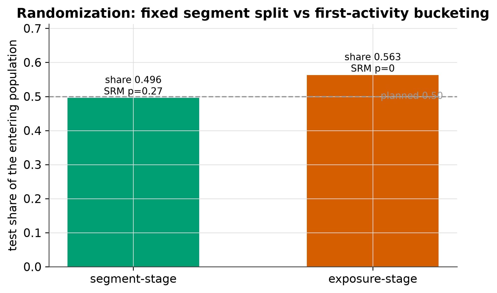
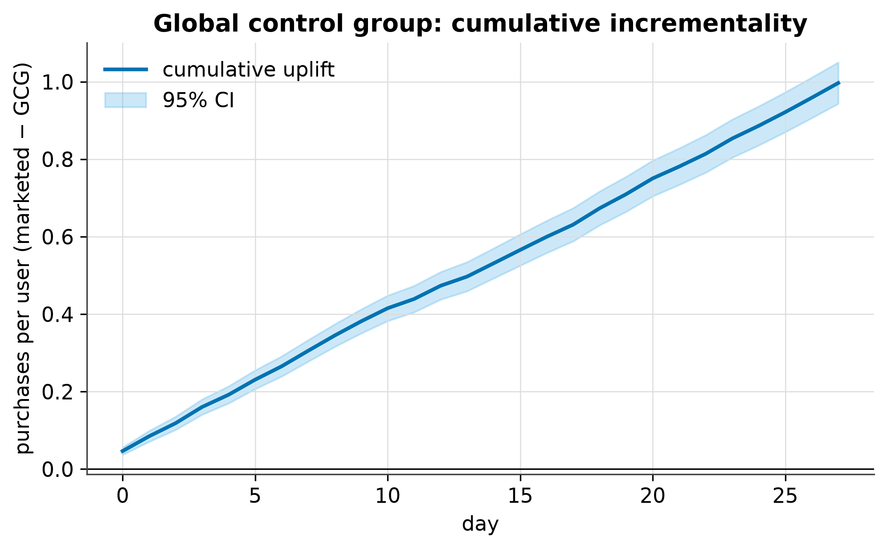
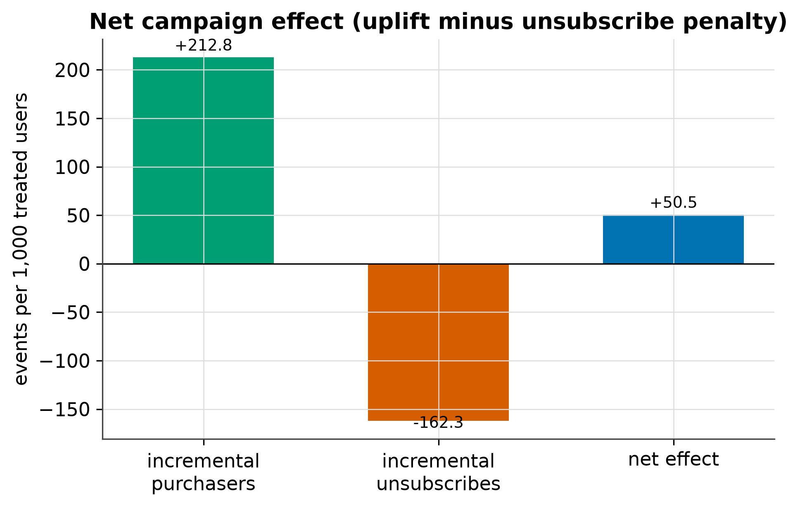

# CRM Experiment Lab — pipeline report

Synthetic CRM experiment: **20,000 users**, **28 days**, **12 campaigns** (4 offered per user/day, daily cap 3), seed `42`. All numbers below are produced by `scripts/run_full_pipeline.py` from a known data-generating process.

## Headline

| Analysis | Result | Reading |
|---|---|---|
| Randomization (SRM) | segment p=0.266, exposure p=0 | fixed split share 0.496 is balanced; first-activity bucketing share 0.563 is not |
| GCG cumulative uplift | +0.9968 / user by day 27 [+0.9433, +1.0502] | marketed minus global control, purchases per user; CI excludes 0 |
| GCG refresh stability | CV full=0.3280 vs partial=0.0090 | partial rotation keeps the control baseline stable |
| Net effect / 1k treated | +50.5 (uplift +212.8 minus unsub 162.3) | positive net once unsubscribes are priced in |
| Exposure window | SE any=0.00066 vs windowed=0.00124 | on the default DGP the window anchors the horizon, not the SE; on a transient effect it lifts sensitivity 7.6 -> 12.3 (effect/SE) |
| Guardrails | 1 of 2 breached | unsubscribe guardrail breaches, the daily send cap holds |

## 1. Randomization: segment-stage vs exposure-stage

CRM has to bucket a user **once**, when the campaign segment is built, and keep that group for every campaign. The product habit of bucketing a user when they "show up" on launch day instead drops the part of the control arm that arrives later, so the entering population no longer matches the assigned one and the sample-ratio-mismatch check fires even though the assignment itself was clean.

| Stage | test share | test | control | SRM p-value |
|---|---|---|---|---|
| segment (CRM-correct) | 0.4958 | - | - | 0.266 |
| exposure (product-style) | 0.5629 | - | - | 0 |

> segment-stage buckets test=8881 control=9030 (test share 0.496, SRM p=0.266); exposure-stage buckets test=8881 control=6897 (test share 0.563, SRM p=0). The fixed assignment is balanced; bucketing on first activity breaks it.

## 2. Global control group: cumulative incrementality

A share of users is held out of **all** marketing and used to estimate the cumulative platform-wide uplift. The control is refreshed periodically; a partial rotation keeps the baseline stable, a full reshuffle makes it jump.

| day | uplift | ci_low | ci_high |
|---|---|---|---|
| 25 | 0.9215 | 0.8702 | 0.9728 |
| 26 | 0.9587 | 0.9063 | 1.0110 |
| 27 | 0.9968 | 0.9433 | 1.0502 |

| Refresh strategy | CV of uplift trend | Reading |
|---|---|---|
| full reshuffle | 0.3280 | control baseline jumps |
| partial (config share) | 0.0090 | stable, lower variation |

## 3. Net effect of campaigns (net of unsubscribes)

A campaign only pays off if the incremental purchasers it drives outnumber the incremental unsubscribes it causes. Both sides are priced per 1,000 treated users so the sign of the net is directly readable.

| Metric | Per 1,000 treated users |
|---|---|
| incremental purchasers (uplift) | 212.8 |
| incremental unsubscribes (penalty) | 162.3 |
| net effect | 50.5 |
| positivity / negativity ratio | 1.311 |

**Per-campaign balance** (campaigns sorted by net):

| campaign_id | positivity | negativity | net | sign |
|---|---|---|---|---|
| 1 | 203.4716 | 137.3521 | 66.1194 | positive |
| 3 | 203.4716 | 137.3521 | 66.1194 | positive |
| 5 | 203.4716 | 137.3521 | 66.1194 | positive |
| 7 | 203.4716 | 137.3521 | 66.1194 | positive |
| 9 | 203.4716 | 137.3521 | 66.1194 | positive |
| 11 | 203.4716 | 137.3521 | 66.1194 | positive |

**Churn priced in revenue** (one month of ARPU per unsubscribe):

| group | n_users | monthly_unsubscribes | lost_revenue |
|---|---|---|---|
| control | 9030 | 485 | 242500.0000 |
| gcg | 2089 | 129 | 64500.0000 |
| test | 8881 | 1918 | 959000.0000 |

## 4. Exposure-window metric vs all-days metric

A CRM send influences a user for a bounded horizon. The `Is Exposed = True` metric anchors **both arms** at the first exposure day and keeps only the following days. The honest claim is narrow: dropping rows always *raises* a proportion's standard error, so the window is not a free variance reduction. Its value is (a) that it scores the two arms over the same short horizon, and (b) that it preserves the effect when the campaign's influence is transient. The default simulator has a *persistent* effect, so here the window anchors the horizon without shrinking the SE:

| Metric | Effect | Std error | Var signal | Effect / SE |
|---|---|---|---|---|
| all days (Is Exposed = Any) | 0.03621 | 0.00066 | 0.000000432537 | 55.05 |
| windowed (Is Exposed = True) | 0.03598 | 0.00124 | 0.000001529049 | 29.10 |

**When the window actually pays off** — a transient-effect DGP (`window_sensitivity_demo`), where the treated lift exists only inside the window. Windowing no longer just re-anchors the horizon: it stops the worn-off tail from diluting the effect, so both the effect and the signal-to-noise ratio rise.

| Metric (transient DGP) | Effect | Std error | Effect / SE |
|---|---|---|---|
| all days (Is Exposed = Any) | 0.00920 | 0.00122 | 7.55 |
| windowed (Is Exposed = True) | 0.03081 | 0.00251 | 12.28 |

## 5. Guardrails and metric hierarchy

A single headline metric is never optimized alone. The OEC floats on drivers, proxies and debug metrics, and guardrails can block a launch on their own.

| metric | test_value | control_value | delta | threshold | breached |
|---|---|---|---|---|---|
| unsubscribe_rate | 0.2160 | 0.0537 | 0.1623 | 0.0000 | True |
| notifications_per_user_per_day | 3.0000 | 0.0000 | 3.0000 | 3.0000 | False |

| Tier | Metrics |
|---|---|
| OEC | revenue |
| driver | retention_d7, orders_per_user, aov |
| proxy | session_rate |
| debug | send_hour_match, exposure_rate |
| guardrail | unsubscribe_rate, notifications_per_user_per_day |

Balancer daily-cap violations (cap=3): **0** user-days exceeded the cap.

## Figures

*Segment-stage stays at the planned test share; exposure-stage inflates it.*

*Cumulative marketed-minus-GCG uplift with a 95% band.*

*Incremental purchasers, unsubscribe penalty and the net.*

## Limitations & scope

- Everything runs on **synthetic data from a known DGP** (`crm_lab.simulator`): no interference between users, no bots, no delayed conversions, no logging loss, and the planted lift is constant in time.
- There is **no real assignment service, metric store or monitoring** here: the lab is a single-experiment playground, not an experimentation platform.
- The GCG and window comparisons are **estimators exercised on one seed**, not a power study; for calibration of the shared statistics see `tests/test_stats.py`.
- `outputs/report.md` and the three `plots/pipeline_*.png` figures are the only committed artifacts; everything else under `plots/` is regenerated by `scripts/make_figures.py`.
